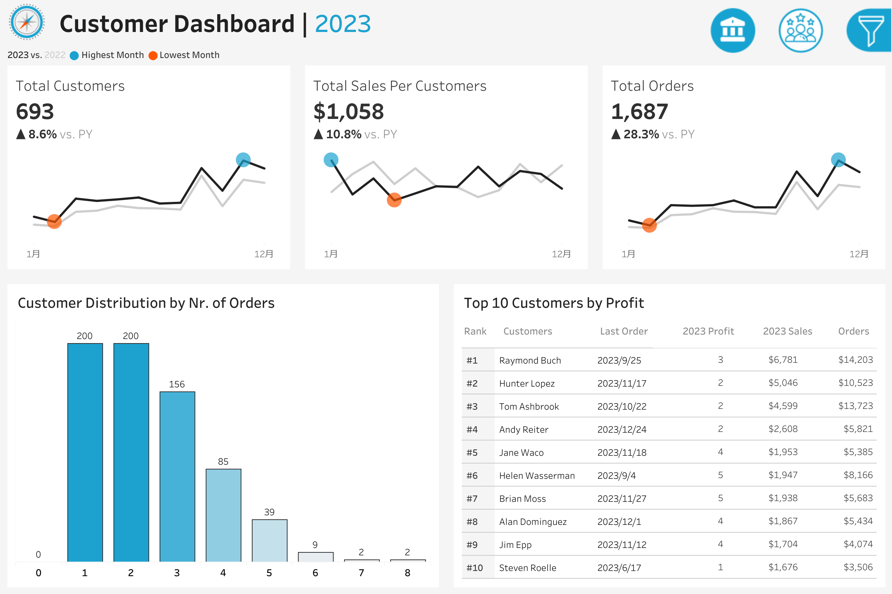

# Sales & Customer Data Visualization with Tableau

## Dashboard Preview

### Sales Dashboard

### Customer Dashboard

## Overview
Using Tableau tools to visualize sales and customer data, including data transformation, relationship modeling across Orders, Customers, Products, and Location, parameter-driven year selection, calculated fields for Current Year and Previous Year Sales, LOD expressions for accurate aggregation, interactive filters, Top N analysis, product performance analysis, YoY growth comparison, min/max sales highlights, KPI dashboards, and PDF report export.

## Live Dashboard
[Sales Dashboard](https://public.tableau.com/app/profile/ethan.auyeung/viz/SalesCustomerDashboards_17918933390310/SalesDashboard)

## Features
- Relationship modeling across Orders, Customers, Products, and Location
- Parameter-driven year selection
- Current Year vs. Previous Year Sales calculated fields
- LOD expressions for accurate aggregation
- Interactive filters
- Top N analysis
- Product performance analysis
- YoY growth comparison
- Min/max sales highlights
- KPI dashboards
- PDF report export

## Tools
- Tableau Public

## Deliverables
- Interactive dashboards
- KPI summary views
- PDF reports

## Usage
1. Open the Tableau workbook.
2. Use the year parameter to select the target year.
3. Interact with filters. 
4. Export dashboards to PDF as needed.
